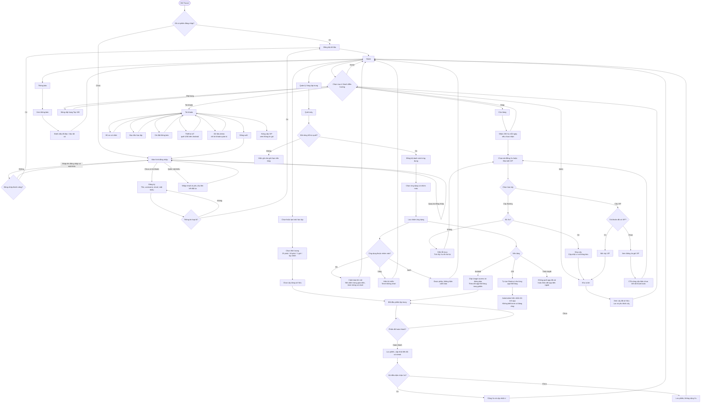

# User flow — Focust

Sơ đồ mô tả luồng người dùng chính theo các màn hình và chức năng hiện có trong ứng dụng.

## Luồng cốt lõi

1. Người dùng đăng nhập hoặc tạo tài khoản; nếu quên mật khẩu, yêu cầu gửi hướng dẫn qua email.
2. Tại **Home**, chọn/tạo task, đặt thời lượng, chọn cây sở hữu rồi bắt đầu phiên tập trung.
3. Khi phiên hoàn thành, ứng dụng lưu tiến độ và streak; phiên đủ điều kiện sẽ được cộng Xu.
4. Xu có thể dùng trong **Cửa hàng** để mở khóa cây; cây đã sở hữu xuất hiện trong **Khu vườn** và có thể chọn cho phiên sau.
5. Người dùng có thể theo dõi **Xếp hạng**, xem **Thông báo**, và chỉnh hồ sơ, mục tiêu, cài đặt trong **Tài khoản**.

## Ghi chú phạm vi

- Đăng nhập dùng tên đăng nhập và mật khẩu; đăng ký yêu cầu tên, username, email, mật khẩu và xác nhận mật khẩu.
- Quét danh sách ứng dụng chỉ khả dụng trên nền tảng native được hỗ trợ; nhắc ứng dụng trong phiên phụ thuộc quyền thiết bị.
- Quét thiết bị USB/OTG hiện hỗ trợ Android native; trình duyệt và iOS chưa hỗ trợ.
- Dữ liệu demo chỉ hiển thị với tài khoản quản trị đã được cấu hình.

## Chi tiết phân loại ứng dụng

| Nhóm | Hành vi trong ứng dụng |
| --- | --- |
| **Đỏ** | Cảnh báo khi mở. Nếu người dùng bấm biểu tượng app Đỏ trong giao diện Home, phiên đang chạy dừng và bộ đếm trở về thời lượng đã chọn. |
| **Vàng** | Hiện lời nhắc khi mở; lời nhắc không reset bộ đếm. |
| **Xanh** | Cho phép sử dụng, không hiện cảnh báo Đỏ/Vàng. |

Người dùng vào **Home → Vùng tập trung → Tùy chỉnh**, chọn ứng dụng, chọn một trong ba nhóm rồi lưu. Có thể quét máy để cập nhật danh sách khi nền tảng hỗ trợ.

- **Android native:** theo dõi ứng dụng Đỏ/Vàng trong phiên cần quyền Usage access và thông báo. Dịch vụ chỉ chạy trong phiên tập trung và dừng khi tạm dừng hoặc kết thúc; ứng dụng không bị chặn.
- **iOS:** cần tự tạo Shortcut automation cho từng ứng dụng Đỏ/Vàng. Shortcut nhắc mỗi khi mở ứng dụng và không biết phiên tập trung có đang chạy hay không.
- **Trình duyệt:** không thể quét danh sách ứng dụng đã cài hoặc theo dõi ứng dụng bên ngoài.

## Luồng Cửa hàng và Khu vườn

- Có thể nhận 200 Xu điểm danh mỗi ngày nếu chưa nhận trong ngày.
- Cửa hàng có tab **Bằng Xu** và **Đặc biệt VIP**. Mua cây thường bằng Xu; nếu giao dịch thất bại, ứng dụng hiển thị lỗi. Cây mua thành công được thêm vào ví và Khu vườn.
- Cây VIP được mở khi tài khoản có VIP. Nút nâng cấp hiện mở thông tin gói VIP; luồng thanh toán chưa được kết nối.
- Khu vườn hỗ trợ lọc tất cả cây, cây hiếm, cây yêu thích và bật/tắt yêu thích. Cây đã sở hữu có thể chọn trong phiên tập trung.
