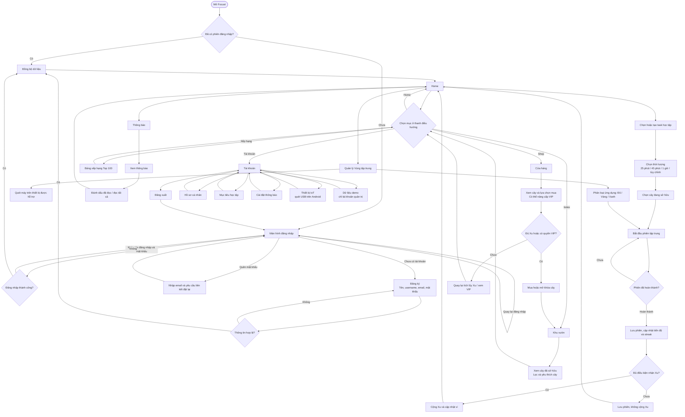

# User flow — Focust

Sơ đồ mô tả luồng người dùng chính theo các màn hình và chức năng hiện có trong ứng dụng.

## Luồng cốt lõi

1. Người dùng đăng nhập hoặc tạo tài khoản; nếu quên mật khẩu, yêu cầu gửi hướng dẫn qua email.
2. Tại **Home**, chọn/tạo task, đặt thời lượng, chọn cây sở hữu rồi bắt đầu phiên tập trung.
3. Khi phiên hoàn thành, ứng dụng lưu tiến độ và streak; phiên đủ điều kiện sẽ được cộng Xu.
4. Xu có thể dùng trong **Cửa hàng** để mở khóa cây; cây đã sở hữu xuất hiện trong **Khu vườn** và có thể chọn cho phiên sau.
5. Người dùng có thể theo dõi **Xếp hạng**, xem **Thông báo**, và chỉnh hồ sơ, mục tiêu, cài đặt trong **Tài khoản**.

## Ghi chú phạm vi

- Đăng nhập dùng tên đăng nhập và mật khẩu; đăng ký yêu cầu tên, username, email, mật khẩu và xác nhận mật khẩu.
- Quét danh sách ứng dụng chỉ khả dụng trên nền tảng native được hỗ trợ; nhắc ứng dụng trong phiên phụ thuộc quyền thiết bị.
- Quét thiết bị USB/OTG hiện hỗ trợ Android native; trình duyệt và iOS chưa hỗ trợ.
- Dữ liệu demo chỉ hiển thị với tài khoản quản trị đã được cấu hình.
